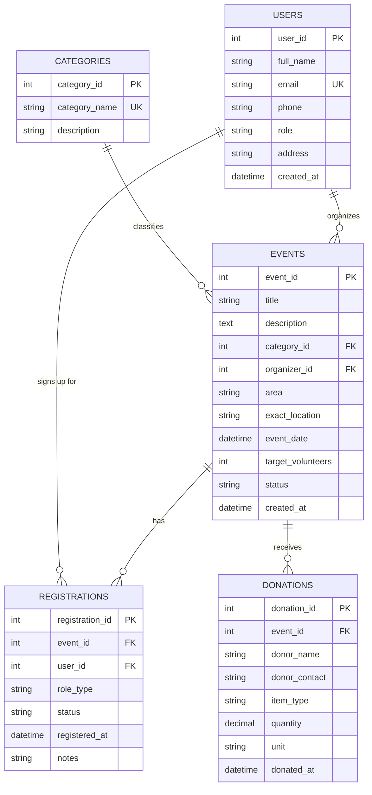

# ER Diagram & Relational Schema (Normalized to 3NF)
## Project: Social Development Events Platform (CommunityAid Dhaka)

---

## 1. System Overview
The **Social Development Events Platform** is a community-driven web application designed to organize, coordinate, and track localized social welfare and humanitarian initiatives across Dhaka (such as *Winter Clothes Distribution in Mirpur 10*, *Emergency Blanket Distribution in Mohammadpur*, *Free Medical Camps in Slum Communities*, and *Tree Plantation Drives*).

The system allows:
1. **Organizers** to create and manage social events, define targeted volunteer quotas, and track event progress.
2. **Volunteers** to explore events, register for specific roles (general, medic, logistics), and monitor their participation status.
3. **Donors & Supporters** to log contributed goods (blankets, sweaters, medicines, dry food, funds).
4. **Administrators / Public** to query analytics, search events by locality and category, and view combined reports.

---

## 2. Relational Database Schema (Standard Notation)

Primary keys are marked with `(PK)`, Foreign keys are marked with `(FK)`.

1. **`USERS`**
   - **`USERS`** (<u>`user_id`</u>, `full_name`, `email`, `phone`, `role`, `address`, `created_at`)
   - **PK**: `user_id`
   - **Unique Key**: `email`

2. **`CATEGORIES`**
   - **`CATEGORIES`** (<u>`category_id`</u>, `category_name`, `description`)
   - **PK**: `category_id`
   - **Unique Key**: `category_name`

3. **`EVENTS`**
   - **`EVENTS`** (<u>`event_id`</u>, `title`, `description`, `category_id`*(FK)*, `organizer_id`*(FK)*, `area`, `exact_location`, `event_date`, `target_volunteers`, `status`, `created_at`)
   - **PK**: `event_id`
   - **FK 1**: `category_id` $\rightarrow$ `CATEGORIES(category_id)` (ON UPDATE CASCADE, ON DELETE RESTRICT)
   - **FK 2**: `organizer_id` $\rightarrow$ `USERS(user_id)` (ON UPDATE CASCADE, ON DELETE CASCADE)
   - **Check Constraint**: `target_volunteers > 0`

4. **`REGISTRATIONS`**
   - **`REGISTRATIONS`** (<u>`registration_id`</u>, `event_id`*(FK)*, `user_id`*(FK)*, `role_type`, `status`, `registered_at`, `notes`)
   - **PK**: `registration_id`
   - **FK 1**: `event_id` $\rightarrow$ `EVENTS(event_id)` (ON UPDATE CASCADE, ON DELETE CASCADE)
   - **FK 2**: `user_id` $\rightarrow$ `USERS(user_id)` (ON UPDATE CASCADE, ON DELETE CASCADE)
   - **Unique Constraint**: `(event_id, user_id)` (prevents duplicate registrations for the same user in the same event)

5. **`DONATIONS`**
   - **`DONATIONS`** (<u>`donation_id`</u>, `event_id`*(FK)*, `donor_name`, `donor_contact`, `item_type`, `quantity`, `unit`, `donated_at`)
   - **PK**: `donation_id`
   - **FK**: `event_id` $\rightarrow$ `EVENTS(event_id)` (ON UPDATE CASCADE, ON DELETE CASCADE)
   - **Check Constraint**: `quantity > 0`

---

## 3. Normalization Analysis (Up to 3NF)

### Functional Dependencies (FDs)
- **USERS**:
  - $FD_1$: `user_id` $\rightarrow$ `full_name`, `email`, `phone`, `role`, `address`, `created_at`
  - $FD_2$: `email` $\rightarrow$ `user_id`, `full_name`, `phone`, `role`, `address`, `created_at`
  - *Candidate Keys*: `{user_id}`, `{email}`

- **CATEGORIES**:
  - $FD_3$: `category_id` $\rightarrow$ `category_name`, `description`
  - $FD_4$: `category_name` $\rightarrow$ `category_id`, `description`
  - *Candidate Keys*: `{category_id}`, `{category_name}`

- **EVENTS**:
  - $FD_5$: `event_id` $\rightarrow$ `title`, `description`, `category_id`, `organizer_id`, `area`, `exact_location`, `event_date`, `target_volunteers`, `status`, `created_at`
  - *Candidate Key*: `{event_id}`

- **REGISTRATIONS**:
  - $FD_6$: `registration_id` $\rightarrow$ `event_id`, `user_id`, `role_type`, `status`, `registered_at`, `notes`
  - $FD_7$: `{event_id, user_id}` $\rightarrow$ `registration_id`, `role_type`, `status`, `registered_at`, `notes`
  - *Candidate Keys*: `{registration_id}`, `{event_id, user_id}`

- **DONATIONS**:
  - $FD_8$: `donation_id` $\rightarrow$ `event_id`, `donor_name`, `donor_contact`, `item_type`, `quantity`, `unit`, `donated_at`
  - *Candidate Key*: `{donation_id}`

---

### Step-by-Step Normalization Proof

#### 1. First Normal Form (1NF) Compliance:
- **Condition**: A relation is in 1NF if and only if all underlying domains contain only atomic (indivisible) values, there are no repeating groups, and every table possesses a primary key.
- **Verification**:
  - In `USERS`, `CATEGORIES`, `EVENTS`, `REGISTRATIONS`, and `DONATIONS`, each field holds a single value (e.g. single phone number, single category, distinct timestamps).
  - Multi-valued attributes like multiple volunteers per event or multiple donations are resolved into separate relations (`REGISTRATIONS` and `DONATIONS`) rather than comma-separated strings.
  - Hence, all tables are strictly in **1NF**.

#### 2. Second Normal Form (2NF) Compliance:
- **Condition**: A relation is in 2NF if it is in 1NF and every non-prime attribute is fully functionally dependent on the primary key (no partial dependencies on a composite candidate key).
- **Verification**:
  - `USERS`, `CATEGORIES`, `EVENTS`, `DONATIONS` all have single-attribute primary keys (`user_id`, `category_id`, `event_id`, `donation_id`). Therefore, partial dependency is impossible.
  - In `REGISTRATIONS`, the primary key is `registration_id`. The alternative composite key `{event_id, user_id}` fully determines the non-key attributes (`role_type`, `status`, `registered_at`, `notes`). Neither `event_id` alone nor `user_id` alone determines the registration status or role.
  - Hence, all relations are in **2NF**.

#### 3. Third Normal Form (3NF) Compliance:
- **Condition**: A relation is in 3NF if it is in 2NF and there is no transitive dependency of non-prime attributes on any candidate key (for every functional dependency $X \rightarrow Y$, either $X$ is a superkey or $Y$ is a prime attribute).
- **Verification**:
  - **EVENTS**: Does `category_name` depend on `category_id` inside `EVENTS`? No; `category_name` is stored only in `CATEGORIES`. In `EVENTS`, only `category_id` (a foreign key) is kept.
  - Similarly, organizer details (`full_name`, `phone`) are not stored inside `EVENTS`; only `organizer_id` is maintained.
  - In `REGISTRATIONS`, only references (`event_id`, `user_id`) and registration-specific attributes are stored.
  - In `DONATIONS`, only event-specific donation entries are kept.
  - No non-prime attribute determines another non-prime attribute.
  - Hence, all relations are in **3NF**.

---

## 4. Entity-Relationship (ER) Diagram

### Mermaid Notation

---

## 5. Cardinality and Relationships Summary

| Entity 1 | Relationship | Entity 2 | Cardinality | Explanation |
| :--- | :---: | :--- | :---: | :--- |
| **USERS** | Organizes | **EVENTS** | 1 to $N$ | One user (organizer) can organize zero, one, or multiple events. Each event is organized by exactly one user. |
| **CATEGORIES** | Classifies | **EVENTS** | 1 to $N$ | One category groups multiple events. Each event belongs to exactly one category. |
| **EVENTS** | Enrolls | **REGISTRATIONS** | 1 to $N$ | One event can have multiple volunteer registrations. Each registration belongs to one event. |
| **USERS** | Registers as | **REGISTRATIONS** | 1 to $N$ | One user can register for multiple events. Each registration entry belongs to one user. |
| **EVENTS** | Receives | **DONATIONS** | 1 to $N$ | One event can receive multiple donation entries (blankets, funds, items). |

*(Note: The M:N relationship between USERS and EVENTS for volunteer participation is properly decomposed into the associative entity `REGISTRATIONS` with constraint `(event_id, user_id)` UNIQUE).*
